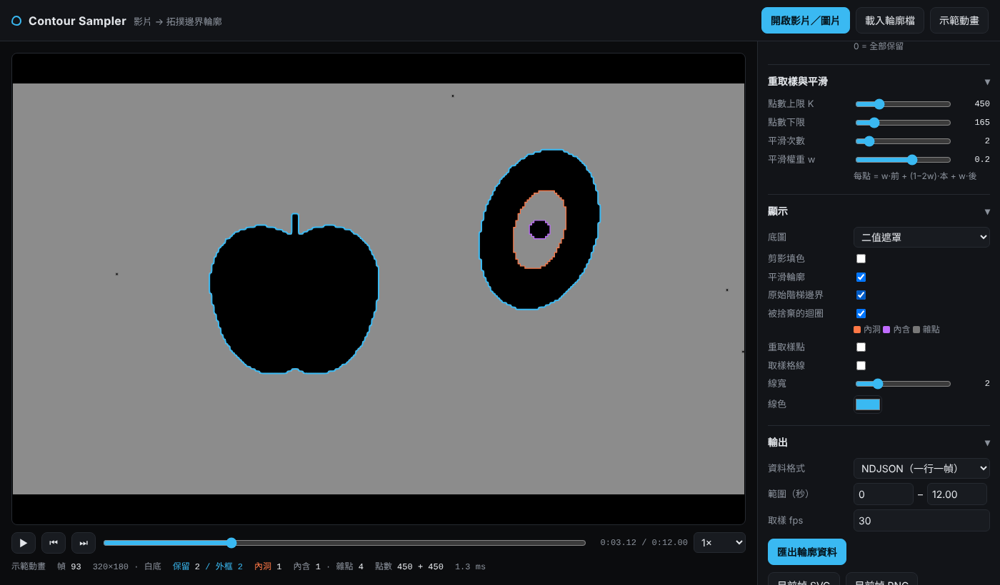

# Contour Sampler 拓撲邊界輪廓取樣儀

[](#)
[](LICENSE)
[](#)
[](#)

> **網頁介面由 Claude (Anthropic) 協同設計與製作**  
> *Web application interface designed and built in collaboration with Claude.*

**影片／圖像 → 乾淨的封閉拓撲輪廓。** 以雙網格（Dual-Grid）演算法追蹤像素邊界，鞋帶公式區分外框與內洞，支援等距重取樣、拉普拉斯平滑與**純線條／剪影**多元格式匯出。零第三方依賴套件。

*Turn any video or image into clean, closed contours. Topological dual-grid boundary tracing, shoelace-formula hole rejection, equidistant resampling, and smoothing — with an in-browser Pro Workstation UI and a zero-dependency CLI.*



---

## 核心亮點 (Highlights)

- **雙語介面（繁體中文 / English）**：頂部導航列支援一鍵即時切換繁體中文與專業英文術語，設定自動於本機儲存。
- **純線條倒出支援 (Pure Outline Export)**：
  - **算圖風格切換**：支援「純線條輪廓 (Outline Only)」、「剪影填色 (Silhouette Fill)」與「完整畫面合成 (Viewport Composite)」。
  - **多元格式匯出**：一鍵匯出純線條向量 SVG、高解析透明/黑底線圖 PNG、即時串流錄製純線條 WebM 影片，以及 BACS、NDJSON、JSON、CSV 軌跡資料。
- **本機端隱私運算**：純前端 Canvas 與記憶體管道處理，零伺服器傳輸，資料完全保存在本地端。
- **由 Claude 構建之工程工作台**：採用抗 AI 樣板之光學儀表深鈦灰質感、取景十字刻度、等寬數字 HUD 遙測數據板與無障礙切換控制器。

---

## 功能規格 (Features)

### 1. 瀏覽器版（`index.html`）
- **媒體載入**：支援將視訊或圖像拖放至畫布（MP4、WebM、MOV、PNG、JPG）。
- **參數調諧面板**：
  - **空間離散化與二值化**：取樣格點（160×90 至 960×540）、亮度門檻（1–254）、邊界極性邏輯（自動 / 固定白底 / 固定黑底）。
  - **拓撲邊界與篩選**：最小迴圈點數、鞋帶公式面積篩選、內含射線判定採樣數與門檻、最大保留外框數。
  - **等距重取樣與平滑**：點數上限 $K$、下限、拉普拉斯平滑迭代次數與權重 $w$。
  - **視圖圖層**：底圖切換（原片 / 暗化 / 二值遮罩 / 黑 / 白）、剪影填色、等值輪廓線、階梯雙網格線、捨棄迴圈分色（內洞 / 內含 / 雜訊）、重取樣節點、雙網格矩陣。
- **播放控制器**：逐幀步進（`←` / `→`）、播放/暫停（`Space`）、自適應進度軸、0.25×–2× 播放速率。
- **輸出管道 (Export Pipeline)**：
  - **算圖風格**：純線條輪廓 (Outline Only) / 剪影填色 (Silhouette) / 視窗合成 (Composite)。
  - **資料軌跡**：整段輪廓序列匯出（NDJSON、JSON、CSV、BACS 二進位）。
  - **向量與影像**：當前幀向量 SVG（支援純線條無背景）、當前幀 PNG、串流錄製 WebM 影片（可附帶原音訊）。
  - **軌跡回放**：支援載入先前提取之 `.bacs` 或 `.ndjson` 檔即時播放。
  - **幾何基準測試**：內建合成測試動畫（包含自轉環、內洞、被包覆的小島與高頻雜訊點）。

### 2. 命令列版（`cli/`）
- `cli/sample.js`：任何 ffmpeg 可解碼之視訊/圖像序列 → 輪廓資料，或每幀獨立 SVG 序列。
- `cli/decode.js`：輪廓資料還原為剪影視訊、**純輪廓線視訊（`--mode outline`）**、PNG 序列、SVG 序列，可自動對齊附帶原音訊；各資料格式自由互轉。

---

## 快速開始 (Quick Start)

### 瀏覽器版 (Web UI)

```bash
git clone https://github.com/kevinshao2217/caustic_wavetank.git
cd caustic_wavetank
npm start            # 等同 npx http-server -p 8080 .，瀏覽器開啟 http://localhost:8080
```

或使用 Python 內建靜態伺服器：
```bash
python -m http.server 8080
```

> **GitHub Pages 部署**：Settings → Pages → Source 選擇 `main` 分支根目錄即可自動上線。  
> 網址後方帶參數 `?demo` 可自動載入示範動畫（例如 `https://kevinshao2217.github.io/caustic_wavetank/?demo`）。

### 命令列版 (CLI - 需要 Node.js 18+ 與 ffmpeg)

```bash
# 1. 提取輪廓資料
node cli/sample.js input.mp4 -o out.bacs --start 0 --duration 10
node cli/sample.js input.mp4 --res 640x360 --threshold 100 --maxLoops 0 -o out.ndjson

# 2. 還原為純輪廓線視訊 (純線條模式)
node cli/decode.js out.bacs -o lines.mp4 --mode outline --line 3 --lineColor #38bdf8

# 3. 還原為黑白剪影視訊 (附帶原影片音軌)
node cli/decode.js out.bacs -o decoded.mp4 --mode fill --audio input.mp4

# 4. 匯出每幀向量 SVG 序列
node cli/decode.js out.bacs -o svg_frames/ --format svg

# 5. 執行無相依單元自我測試
npm test
```

---

## 演算法步驟 (Algorithm)

1. **空間縮放**：將輸入影像縮至 $W \times H$ 灰階網格（預設 320 × 180）。
2. **極性判定**：統計外框邊界亮度，自動判斷背景為白底（前景暗）或黑底（前景亮）。
3. **二值化**：依亮度門檻生成布林像素矩陣。
4. **雙網格邊界建立**：遍歷每條交界邊，建立沿像素邊界的有向拓撲邊，使前景恆在行進方向右側。
5. **閉合迴圈追蹤**：尤拉路徑閉合追蹤，保證輪廓為 100% 封閉環，無懸空飛線。
6. **鞋帶公式分類**（有號面積 $A = \frac{1}{2}\sum (x_i y_{i+1} - x_{i+1} y_i)$）：
   - 頂點數 $< \text{minLoopPoints} \to$ 雜訊點濾除。
   - $A \le 0 \to$ **內洞 (Hole)**（逆時針方向）。
   - $0 < A \le \text{minArea} \to$ 微小碎片濾除。
   - 射線法均勻採樣投票 $\to$ 判斷是否為巢狀包含於外框內之孤島。
7. **等距重取樣與平滑**：依弧長等距取樣成 $K$ 點，執行封閉拉普拉斯環狀鬆弛濾波 $P_i \leftarrow w P_{i-1} + (1-2w) P_i + w P_{i+1}$。

---

## 數據格式 (Data Formats)

座標單位統一為取樣格點：$x \in [0, W], y \in [0, H]$，向下為正。

| 格式 | 說明 | 特點 |
|---|---|---|
| `.bacs` | 二進位封裝 (Binary Adapted Contour Stream) | 體積最小（約為 NDJSON 之 25%），適合高頻寬低延遲傳輸 |
| `.ndjson` | 每行單幀 JSON 物件 | 支援串流讀取，相容 Python / Pandas / Node 串接 |
| `.json` | 完整單一陣列 JSON | 結構完整，適合單一檔案解析 |
| `.csv` | 點座標矩陣表格 | `frame,time,whiteBg,loop,area,rawPoints,idx,x,y` |
| `.svg` | 向量幾何路徑 | 支援向量放大無損、純線條輪廓無背景輸出 |

---

## 專案結構 (Repository Structure)

```
├── index.html            # 瀏覽器工作台入口（支援雙語、純線條倒出、Claude 製作標註）
├── web/
│   ├── app.js            # 介面互動、i18n 字典、算圖管道與串流錄製
│   └── style.css         # Pro Max 工程工作台樣式系統（深鈦色階、HUD 遙測、開關）
├── src/
│   ├── sampler-core.js   # 拓撲雙網格核心演算法（瀏覽器與 Node 雙相容）
│   └── formats.js        # BACS / NDJSON / JSON / CSV / SVG 編解碼引擎
├── cli/
│   ├── sample.js         # CLI 視訊取樣指令
│   └── decode.js         # CLI 輪廓還原與格式轉換工具（支援 --mode outline）
├── test/
│   └── selftest.js       # 演算法與編解碼單元測試
├── README.md             # 說明文件（繁體中文 / English）
└── package.json
```

---

## 授權 (License)

本專案採用 [MIT License](LICENSE) 授權。
